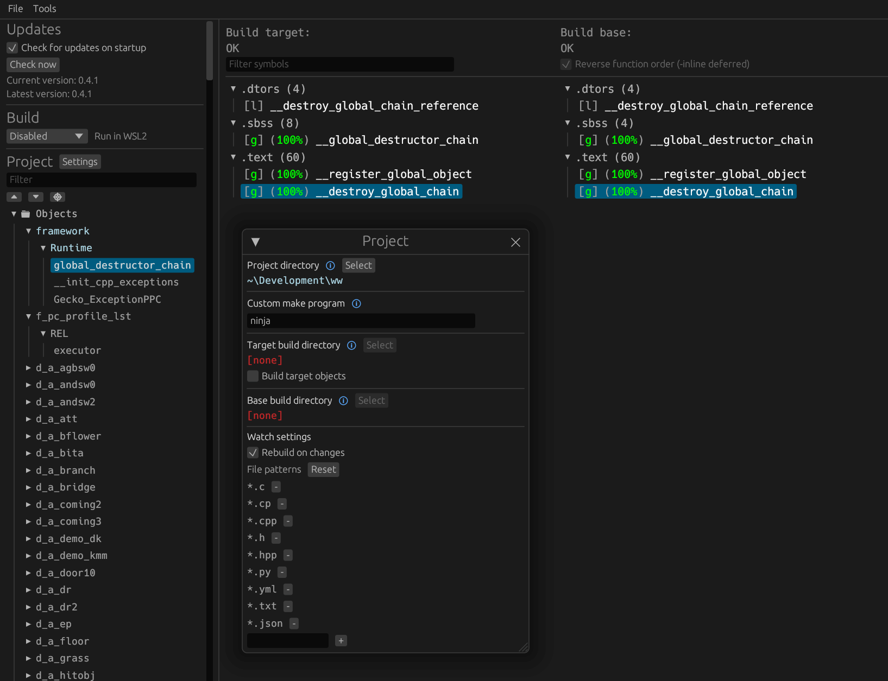

Skies of Arcadia Legends
=============

A work-in-progress decompilation of Skies of Arcadia Legends.

This repository does **not** contain any game assets or assembly whatsoever. An existing copy of the game is required.

Supported versions:

- `GEAE8P`: Rev 0 (USA)

Dependencies
============

Windows
--------

On Windows, it's **highly recommended** to use native tooling. WSL or msys2 are **not** required.  
When running under WSL, [objdiff](#diffing) is unable to get filesystem notifications for automatic rebuilds.

- Install [Python](https://www.python.org/downloads/) and add it to `%PATH%`.
  - Also available from the [Windows Store](https://apps.microsoft.com/store/detail/python-311/9NRWMJP3717K).
- Download [ninja](https://github.com/ninja-build/ninja/releases) and add it to `%PATH%`.
  - Quick install via pip: `pip install ninja`

macOS
------

- Install [ninja](https://github.com/ninja-build/ninja/wiki/Pre-built-Ninja-packages):

  ```sh
  brew install ninja
  ```

[wibo](https://github.com/decompals/wibo), a minimal 32-bit Windows binary wrapper, will be automatically downloaded and used.

Linux
------

- Install [ninja](https://github.com/ninja-build/ninja/wiki/Pre-built-Ninja-packages).

[wibo](https://github.com/decompals/wibo), a minimal 32-bit Windows binary wrapper, will be automatically downloaded and used.

Building
========

- Clone the repository:

  ```sh
  git clone <repo url>
  ```

- Copy your game's disc image to `orig/GEAE8P`.
  - Supported formats: ISO (GCM), RVZ, WIA, WBFS, CISO, NFS, GCZ, TGC
  - After the initial build, the disc image can be deleted to save space.

- Configure:

  ```sh
  python configure.py
  ```

  To use a version other than `GEAE8P` (USA), specify it with `--version`.

- Build:

  ```sh
  ninja
  ```

Diffing
=======

Once the initial build succeeds, an `objdiff.json` should exist in the project root.

Download the latest release from [encounter/objdiff](https://github.com/encounter/objdiff). Under project settings, set `Project directory`. The configuration should be loaded automatically.

Select an object from the left sidebar to begin diffing. Changes to the project will rebuild automatically: changes to source files, headers, `configure.py`, `splits.txt` or `symbols.txt`.



Status
======

<!-- status:begin -->
_Generated by `tools/update_status.py` on 2026-10-25._

| | |
|---|---|
| `main.dol` | rebuilds byte-identical |
| All code linked from C | 447,984 / 2,782,996 bytes (8.30%), 2,248 / 7,116 functions |
| Game code | 218,560 bytes, 1,459 functions, 1 files |
| Library code (SDK/MSL/TRK) | 96,668 bytes, 434 functions, 87 files (87 imported from tw2004) |
| Middleware (MusyX) | 132,756 bytes, 355 functions, 28 files (28 imported from AxioDL/musyx) |
<!-- status:end -->

Refresh with `python tools/update_status.py` after `ninja`. Other docs link here rather than repeating numbers.

Project notes
=============

- Work in progress, near misses, what blocks linking and the agent batch workflow: [docs/progress.md](docs/progress.md).
- Single `main.dol`, no RELs. Game code runs from `0x80005600` to about `0x80231A7C`. Library code follows: Dolphin SDK (Sep 5 2002, `0x2301`), MetroTRK, MSL, Factor 5's MusyX 2.0.0 sound system, then Sega's Ninja graphics library (~150 KB, named by behavior: [docs/ninja.md](docs/ninja.md)).
- Game code compiler: MWCC **GC/1.3.2** with `-use_lmw_stmw on` and `-inline noauto`. Evidence is in [docs/compiler.md](docs/compiler.md).
- Library code (SDK/MSL/TRK and MusyX) and how it's imported, plus why some files are rejected and are good next targets: [docs/sdk_import.md](docs/sdk_import.md). Provenance and licenses: [extern/README.md](extern/README.md).
- `config/GEAE8P/ldscript.lcf` overrides dtk's default linker script. The game's MetroTRK debugger stack is 0x5000 bytes, not 0x2000.
- Ninja library map, names and port hook points (widescreen, frame interpolation): [docs/ninja.md](docs/ninja.md).
- Projection, the 2D layer and what widescreen changes: [docs/widescreen.md](docs/widescreen.md).
- The frame loop, frame pacing and why the game is fixed-step at 30 fps: [docs/frame_loop.md](docs/frame_loop.md).
- Menus, HUD and the 2D layer (draw state stack, text queue, layouts, the UiObj animation every menu element uses, where each screen parks hidden elements): [docs/ui.md](docs/ui.md). Game code built from C so far lives in `src/game/`.
- Cameras per mode, the camera manager and what player camera control needs (implemented in the recomp): [docs/camera.md](docs/camera.md).
- Random encounters, battle rewards (EXP, gold, magic EXP), battle speed, the battle unit records, damage, and the buttons each mode uses (the recomp's options and Invincible): [docs/qol_cheats.md](docs/qol_cheats.md).
- The sound layer between the game and MusyX (banks, music lists, sound effects, streams, the Dreamcast file mapping), written for the recomp's Dreamcast music: [docs/sound.md](docs/sound.md).
- Native static recomp (DolRecomp + ModernGekko, GPL-3, kept separate): `../SkiesOfArcadiaLegends-Recomp/`. It reads this repo's `symbols.txt` for function names, and its game patches (widescreen, camera, options) are built on the research in these docs.
- Research notes: `../GameCube-Research/`.

Tools
-----

| Tool | Purpose |
|---|---|
| `tools/cwprobe.py` | Compile a C file with several MWCC versions and compare each function against the original (relocations masked). `probe/` has matched examples. |
| `tools/tusplit.py` | Locate a compiled object's code and data in `main.dol`, verify it, and print its `splits.txt` entry. |
| `tools/fixsplits.py` | Reconcile split boundaries with dtk's guessed data symbols and close small padding gaps. |
| `tools/import_libs.py` | Re-run the library import (tw2004 checkout + vendored MusyX). |
| `tools/update_status.py` | Regenerate the status block above from the current build. |
| `tools/match/` | Matching game code: `asmindex.py` (call graph, data references, strings, original asm), `fdiff.py` (compile and diff functions), `vrun.py` / `perm.py` / `fvar.py` (variant searches). See [docs/matching.md](docs/matching.md). |
